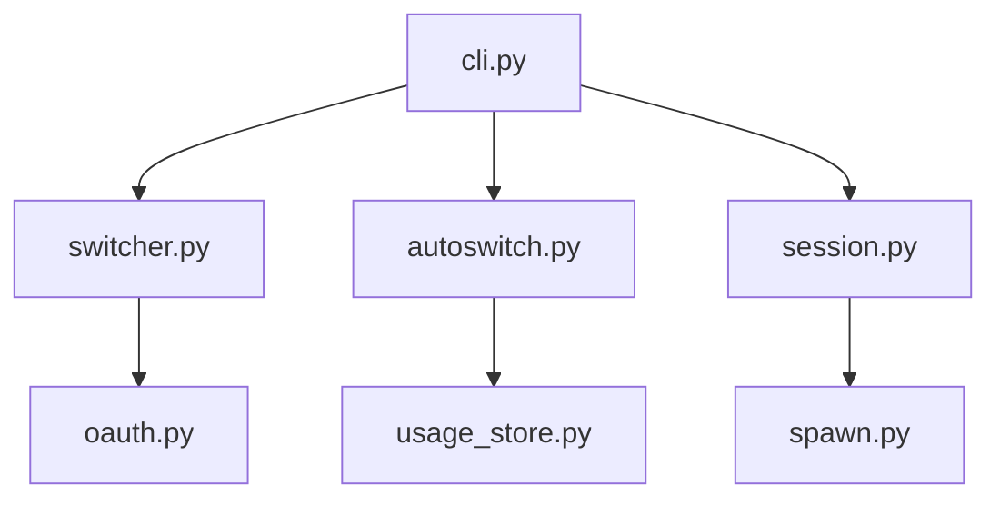

# realiti4/claude-swap

> Switches between several Claude Code accounts, manually or before a usage limit is reached.

## The problem
With several Claude accounts, changing login breaks the session and you cannot see each one's remaining quota.

## What it actually does
Saves each account's OAuth tokens then switches (`cswap switch`), on demand or automatically when the 5-hour or 7-day threshold is reached. TUI dashboard and macOS menu bar showing usage. Session mode to run two accounts in parallel, binding a folder to an account, export and import. Works with the CLI and the VS Code extension.

## How it is wired


## Trying it
```bash
uv tool install claude-swap
cswap add
cswap switch
cswap list
cswap auto
```

## Cost and gotchas
Free. Do not run /logout before adding an account. Exports are unencrypted JSON. Tokens stay local; on macOS they go through the Keychain.

## What it is not
Not a way to increase your quota: it spreads usage across accounts you already own. It applies only to Claude Code.

## Alternatives
No alternative named in the README.

## For you
Worth watching: useful only if you actually juggle several Claude Code accounts, with no stake for the rest of your stack.
