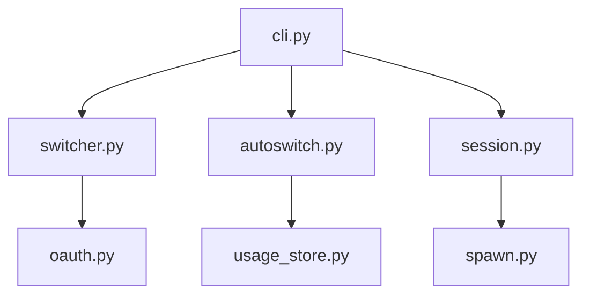

# realiti4/claude-swap

> Bascule entre plusieurs comptes Claude Code, à la main ou avant d'atteindre une limite d'usage.

## Le problème
Avec plusieurs comptes Claude, changer de login casse la session et on ne voit pas le quota restant de chacun.

## Ce que ça fait vraiment
Sauvegarde les jetons OAuth de chaque compte puis bascule (`cswap switch`), à la demande ou automatiquement quand le seuil de 5 h ou 7 jours est atteint. Tableau de bord TUI et barre de menus macOS avec l'usage. Mode session pour lancer deux comptes en parallèle, liaison d'un dossier à un compte, export et import. Fonctionne avec le CLI et l'extension VS Code.

## Comment c'est branché


## Essayer
```bash
uv tool install claude-swap
cswap add
cswap switch
cswap list
cswap auto
```

## Coût et pièges
Gratuit. Ne pas faire /logout avant d'ajouter un compte. Les exports sont en JSON non chiffré. Les jetons restent en local ; sous macOS ils passent par le Trousseau.

## Ce que ce n'est pas
Pas un moyen d'augmenter ton quota : il répartit entre comptes que tu possèdes déjà. Il ne s'applique qu'à Claude Code.

## Alternatives
Aucune alternative nommée dans le README.

## Pour toi
À surveiller : utile seulement si tu jongles réellement entre plusieurs comptes Claude Code, sans enjeu pour le reste de ta stack.

