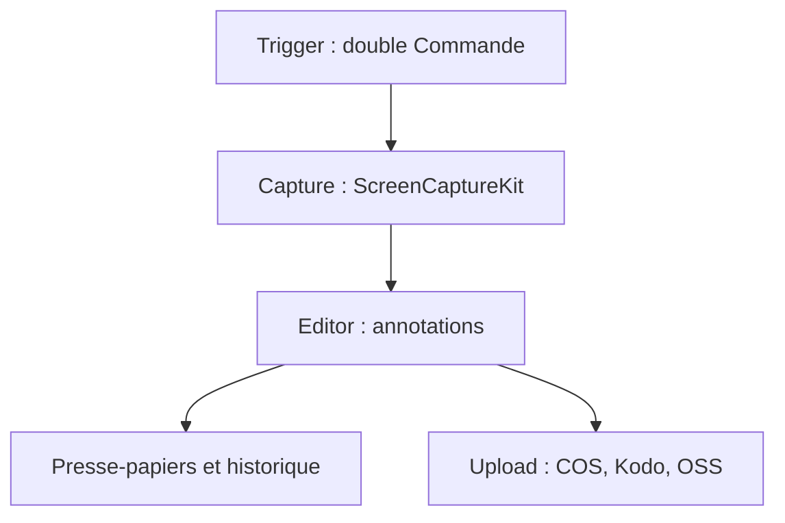

# realskyrin/capcap

> Screenshot tool for macOS 14 and later: annotations, scrolling capture, beautify, pinning.

## The problem
macOS screenshots require several tools to annotate, stitch a long page and share the result.

## What it actually does
A double press on Command starts the capture. The editor offers annotations that remain editable afterwards, long captures, a beautify mode and pinning above windows. OCR goes through Apple Vision, translation through Apple Translation, DeepL or a service of your choice. Upload to COS, Kodo or OSS is possible. No telemetry, native AppKit.

## How it is wired
Simplified diagram based on the sheet, no diagram provided.


## Trying it
```bash
brew tap realskyrin/tap
brew trust realskyrin/capcap
brew install --cask realskyrin/tap/capcap
```

## Cost and gotchas
Free. Requires accessibility and screen recording permissions. The README suggests removing the macOS quarantine with `xattr`.

## What it is not
Not a full video recorder nor a cross-platform tool: macOS only. The README is in Chinese.

## Alternatives
No alternative named in the README.

## For you
Ignore for your work: a macOS desktop utility, useful only for annotating documentation screenshots.
