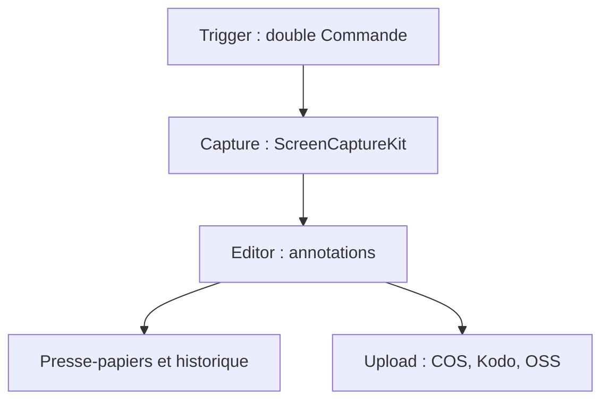

# realskyrin/capcap

> Outil de capture d'écran pour macOS 14 et plus : annotations, capture défilante, embellissement, épinglage.

## Le problème
Les captures d'écran macOS demandent plusieurs outils pour annoter, assembler une longue page et partager le résultat.

## Ce que ça fait vraiment
Un double appui sur Commande lance la capture. L'éditeur permet des annotations modifiables après coup, des captures longues, un mode embellissement et un épinglage au-dessus des fenêtres. L'OCR passe par Apple Vision, la traduction par Apple Translation, DeepL ou un service au choix. Un envoi vers COS, Kodo ou OSS est possible. Sans télémétrie, en AppKit natif.

## Comment c'est branché
Schéma simplifié d'après la fiche, sans diagramme fourni.


## Essayer
```bash
brew tap realskyrin/tap
brew trust realskyrin/capcap
brew install --cask realskyrin/tap/capcap
```

## Coût et pièges
Gratuit. Exige les droits d'accessibilité et d'enregistrement d'écran. Le README propose de retirer la quarantaine macOS avec `xattr`.

## Ce que ce n'est pas
Ce n'est pas un enregistreur vidéo complet ni un outil multiplateforme : macOS seulement. Le README est en chinois.

## Alternatives
Aucune alternative nommée dans le README.

## Pour toi
À ignorer pour ton métier : utilitaire de bureau macOS, utile seulement pour annoter des captures de documentation.

