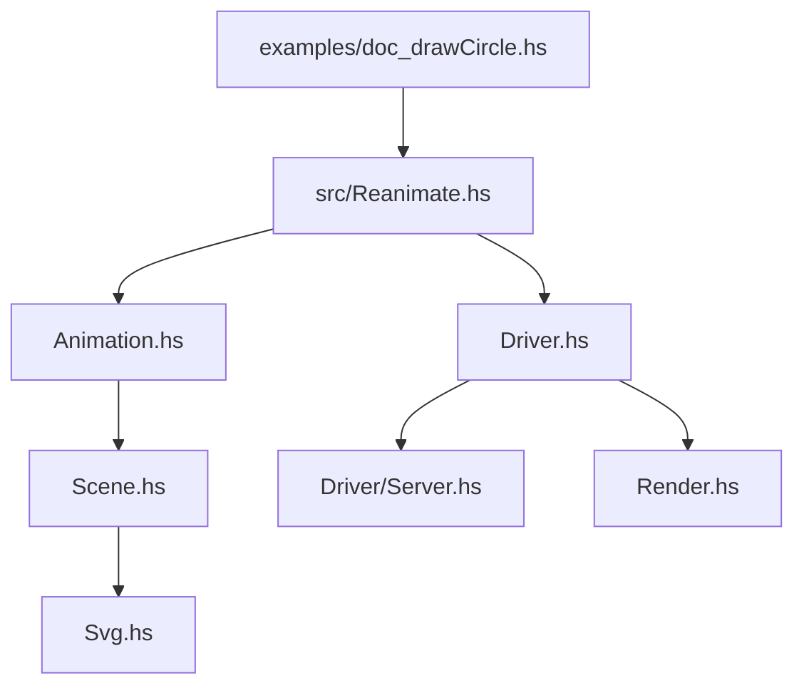

# reanimate/reanimate

> Haskell library for generating mathematical animations in SVG, in the spirit of manim.

## The problem
Animating mathematical figures means gluing together LaTeX, SVG, video encoding and 3D by hand.

## What it actually does
A Haskell script composes Animations and Scenes whose content is SVG (Svg.hs, LaTeX.hs). The Driver serves the animation to the browser via Server.hs and an Elm viewer, or renders it to video with Render.hs and ffmpeg. Options: LaTeX, inkscape, potrace, povray, blender. GeoJSON maps and transcript alignment included.

## How it is wired


## Trying it
```bash
stack new animate github:reanimate/plain
cd animate/
cabal repl
:cmd reanimateLive
```

## Cost and gotchas
Free. Haskell (Stack or Cabal) to install, plus ffmpeg and LaTeX recommended. Last push in February 2025: barely active. The N-Queens tutorial dates from 2019.

## What it is not
Not a ready-to-use tool for non-programmers. Not a Python version of manim.

## Alternatives
manim (3b1b), which the README says it draws inspiration from.

## For you
Ignore: Haskell and barely active, while manim covers the same need in the Python ecosystem.
