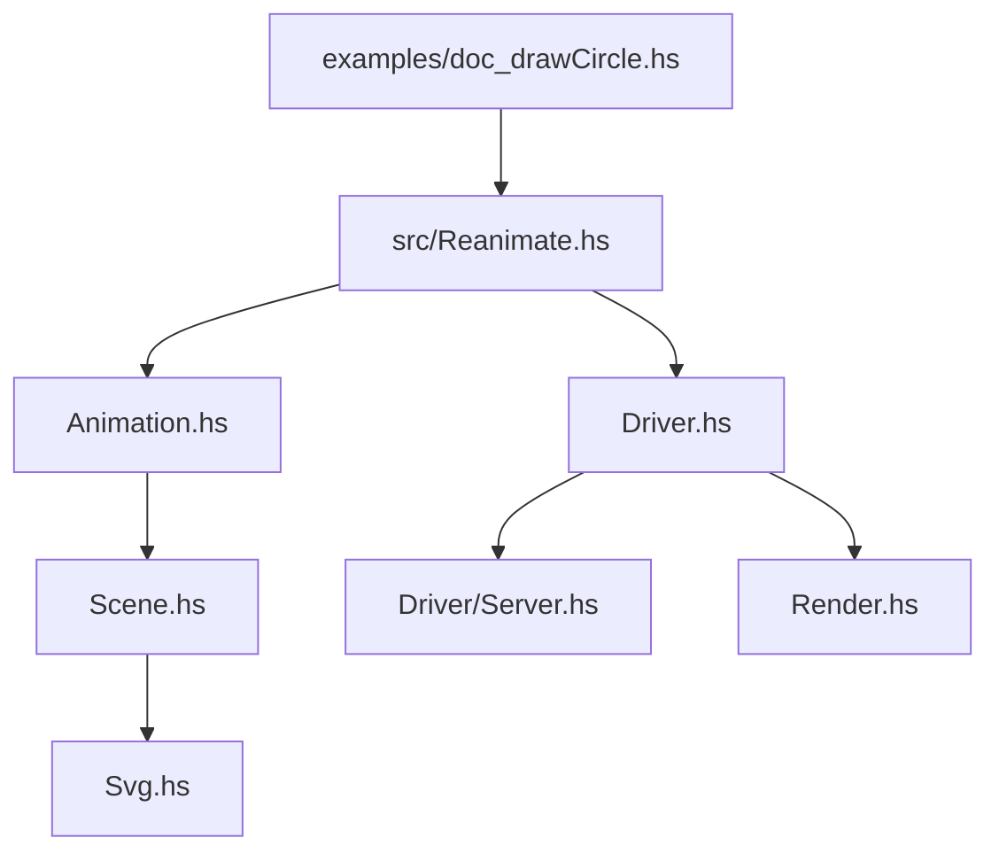

# reanimate/reanimate

> Bibliothèque Haskell pour générer des animations mathématiques en SVG, dans l'esprit de manim.

## Le problème
Animer des figures mathématiques demande de coller à la main LaTeX, SVG, encodage vidéo et 3D.

## Ce que ça fait vraiment
Un script Haskell compose des Animation et des Scene dont le contenu est du SVG (Svg.hs, LaTeX.hs). Le Driver sert l'animation au navigateur via Server.hs et un viewer Elm, ou la rend en vidéo avec Render.hs et ffmpeg. Options : LaTeX, inkscape, potrace, povray, blender. Cartes GeoJSON et alignement sur transcription inclus.

## Comment c'est branché


## Essayer
```bash
stack new animate github:reanimate/plain
cd animate/
cabal repl
:cmd reanimateLive
```

## Coût et pièges
Gratuit. Haskell (Stack ou Cabal) à installer, plus ffmpeg et LaTeX recommandés. Dernier push en février 2025 : peu actif. Le tutoriel N-Queens est daté de 2019.

## Ce que ce n'est pas
Pas un outil prêt à l'emploi pour non-programmeurs. Pas une version Python de manim.

## Alternatives
manim (3b1b), dont le README dit s'inspirer.

## Pour toi
À ignorer : Haskell et peu actif, alors que manim couvre le même besoin dans l'écosystème Python.

