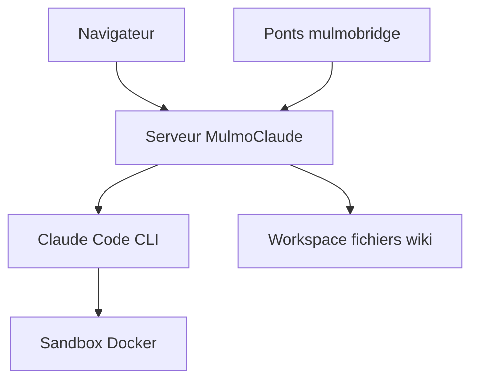

# receptron/mulmoclaude

> Local personal AI assistant built on Claude Code, with a memory wiki, data collections and messaging bridges.

## The problem
An assistant that knows your data is locked inside a vendor; here everything stays in files on your machine.

## What it actually does
A local server that drives Claude Code and displays chat, wiki, RSS feeds, collections, automations and scheduled tasks. Roles (general, office, artist, tutor), launching of your Claude Code skills, and bridges to Telegram, Slack, Discord, e-mail and others. Per-client access tokens, with scopes. Automatic Docker sandbox if Docker is present.

## How it is wired
Simplified diagram based on the sheet, no diagram provided.



## Trying it
```bash
npx mulmoclaude@latest
npx mulmoclaude@latest create-shortcut
npx mulmoclaude token add n8n
git clone git@github.com:receptron/mulmoclaude.git
cd mulmoclaude && yarn install
yarn dev
```

## Cost and gotchas
Node 22.22.2 or later, Claude Code installed and authenticated. Without Docker, Claude can access all the files of your account, SSH keys included. Gemini key for images; ffmpeg for video.

## What it is not
Not a hosted service. Security depends on your configuration: the local token can be read by a process on the same machine.

## Alternatives
No alternative named in the README.

## For you
Worth watching: a good idea of a memory wiki for Claude Code, but file access without a sandbox is a real risk; test it with Docker.
