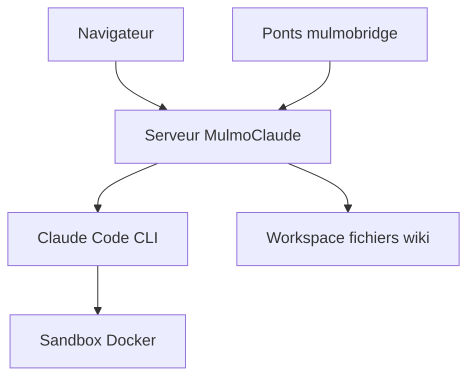

# receptron/mulmoclaude

> Assistant IA personnel local bâti sur Claude Code, avec wiki mémoire, collections de données et ponts de messagerie.

## Le problème
Un assistant qui connaît tes données est enfermé chez un fournisseur ; ici tout reste en fichiers sur ta machine.

## Ce que ça fait vraiment
Un serveur local qui pilote Claude Code et affiche chat, wiki, flux RSS, collections, automatisations et tâches planifiées. Rôles (général, bureau, artiste, tuteur), lancement de tes skills Claude Code, et ponts vers Telegram, Slack, Discord, e-mail et d'autres. Jetons d'accès par client, avec portées. Sandbox Docker automatique si Docker est présent.

## Comment c'est branché
Schéma simplifié d'après la fiche, sans diagramme fourni.



## Essayer
```bash
npx mulmoclaude@latest
npx mulmoclaude@latest create-shortcut
npx mulmoclaude token add n8n
git clone git@github.com:receptron/mulmoclaude.git
cd mulmoclaude && yarn install
yarn dev
```

## Coût et pièges
Node 22.22.2 ou plus, Claude Code installé et authentifié. Sans Docker, Claude accède à tous les fichiers de ton compte, clés SSH comprises. Clé Gemini pour les images ; ffmpeg pour la vidéo.

## Ce que ce n'est pas
Pas un service hébergé. La sécurité dépend de ta configuration : le jeton local peut être lu par un processus de la même machine.

## Alternatives
Aucune alternative nommée dans le README.

## Pour toi
À surveiller : bonne idée de wiki mémoire pour Claude Code, mais l'accès aux fichiers sans sandbox est un risque réel ; teste-le avec Docker.

