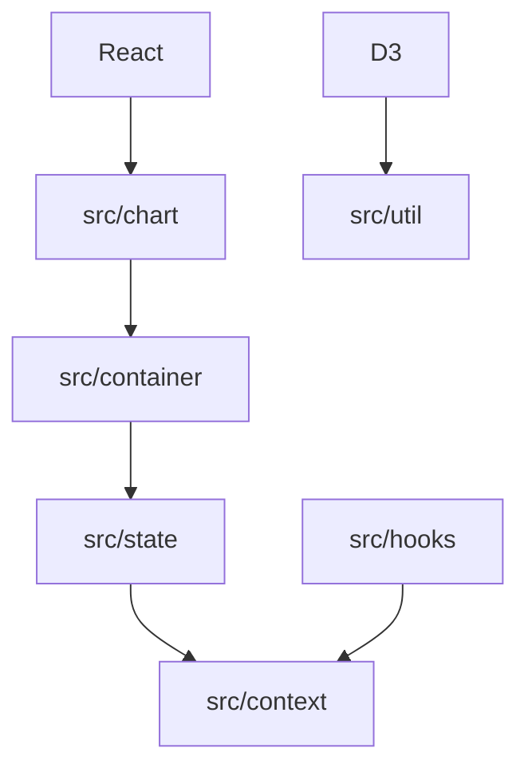

# recharts/recharts

> Chart library of declarative React components, based on D3 and native SVG.

## The problem
Writing charts in a React app without handling D3 by hand.

## What it actually does
Each element (axis, tooltip, grid, line) is an independent React component that you compose inside a `LineChart` or similar. SVG rendering. An internal architecture with Redux state, contexts and hooks, documented through Storybook.

## How it is wired


## Trying it
```bash
npm install recharts react-is
deno add recharts react-is
```

## Cost and gotchas
Free. `react-is` must match your `react` version.

## What it is not
Not a BI tool nor a Python dataviz library: only front-end React charts.

## Alternatives
None named in the README.

## For you
Adopt if you are building a React dashboard for ML metrics: simple, mature and very active.
