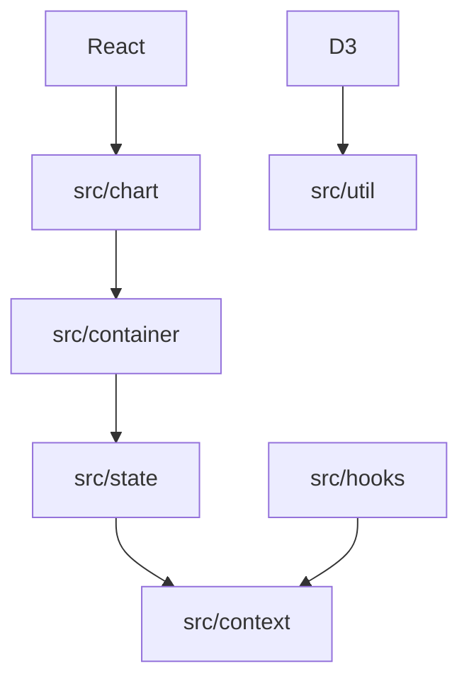

# recharts/recharts

> Bibliothèque de graphiques en composants React déclaratifs, basée sur D3 et SVG natif.

## Le problème
Écrire des graphiques dans une appli React sans manipuler D3 à la main.

## Ce que ça fait vraiment
Chaque élément (axe, tooltip, grille, ligne) est un composant React indépendant que l'on compose dans un `LineChart` ou autre. Rendu SVG. Une architecture interne avec état Redux, contextes et hooks, documentée via Storybook.

## Comment c'est branché


## Essayer
```bash
npm install recharts react-is
deno add recharts react-is
```

## Coût et pièges
Gratuit. `react-is` doit correspondre à ta version de `react`.

## Ce que ce n'est pas
Pas un outil de BI ni de dataviz Python : uniquement des graphiques côté front React.

## Alternatives
Aucune nommée dans le README.

## Pour toi
À adopter si tu construis un dashboard React pour des métriques ML : simple, mature et très actif.

