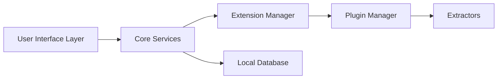

# recloudstream/cloudstream

> Ad-free Android media player with extensions, which provides no video source by default.

## The problem
Bringing several video and audio sources together in a single player with tracking, without ads.

## What it actually does
Android application (phone, TV, Chromecast): bookmarks, extensions for YouTube, Twitch, iptv-org, Librevox, nginx. Without an extension, it plays nothing. The graph is a generated architecture: interface, services (player, download, subtitles), plugin and extractor manager.

## How it is wired

## Trying it
Not documented in the README: installation via the documentation site.

## Cost and gotchas
Free. Third-party extensions are not moderated: risk of copyrighted content.

## What it is not
Not a content provider. The recommended extensions are not endorsed by the project.

## Alternatives
No alternative named in the README.

## For you
Ignore: outside data/AI, with a legal risk tied to extensions.
