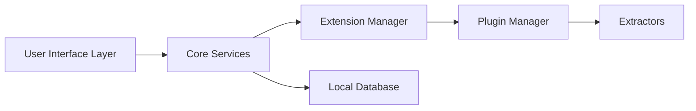

# recloudstream/cloudstream

> Lecteur multimédia Android à extensions, sans pub, qui ne fournit aucune source vidéo par défaut.

## Le problème
Regrouper plusieurs sources vidéo et audio dans un seul lecteur avec suivi, sans publicité.

## Ce que ça fait vraiment
Application Android (téléphone, TV, Chromecast) : marque-pages, extensions pour YouTube, Twitch, iptv-org, Librevox, nginx. Sans extension, elle ne lit rien. Le graphe est une architecture générée : interface, services (lecteur, téléchargement, sous-titres), gestionnaire de plugins et d'extracteurs.

## Comment c'est branché

## Essayer
Non documenté dans le README : installation via le site de documentation.

## Coût et pièges
Gratuit. Les extensions tierces ne sont pas modérées : risque de contenu protégé par le droit d'auteur.

## Ce que ce n'est pas
Pas un fournisseur de contenu. Les extensions recommandées ne sont pas cautionnées par le projet.

## Alternatives
Aucune alternative nommée dans le README.

## Pour toi
À ignorer : hors data/IA, avec un risque juridique lié aux extensions.

