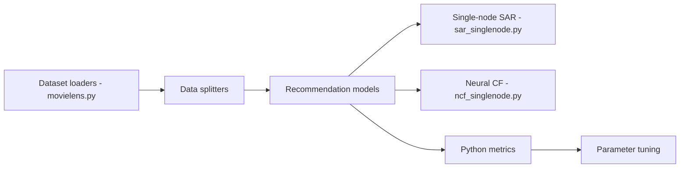

# recommenders-team/recommenders

> Python toolkit and notebooks for prototyping, evaluating and deploying recommender systems.

## The problem
Setting up recommenders requires preparing data, comparing algorithms and evaluating offline in a reproducible way.

## What it actually does
Five tasks: prepare data, model, evaluate, select/optimize, operationalize on Azure. Loading utilities (MovieLens), splitting, and Python/Spark metrics. More than thirty algorithms (ALS, SAR, NCF, LightGCN, SASRec, xDeepFM, Wide & Deep, VAE...), with a MovieLens 100k benchmark in the README. The project is under the Linux Foundation AI & Data.

## How it is wired


## Trying it
```bash
curl -LsSf https://astral.sh/uv/install.sh | sh
uv venv ~/.venvs/recommenders --python 3.11
source ~/.venvs/recommenders/bin/activate
uv pip install recommenders
git clone https://github.com/recommenders-team/recommenders.git
```

## Cost and gotchas
Free. Extras: `[gpu]`, `[spark]`, `[dev]`, `[experimental]`. gcc is required. The documented operationalization targets Azure.

## What it is not
Not a ready-to-deploy recommendation service: these are examples and building blocks. Models marked `*` come from Microsoft; some are experimental.

## Alternatives
No alternative named in the README.

## For you
Adopt it for a recommendation prototype or an algorithm benchmark: broad coverage, MIT, recent activity.
