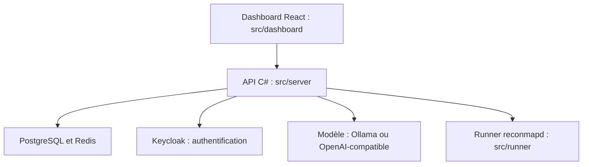

# reconmap/reconmap

> Platform that schedules security scans, triages the results with a language model and writes the report.

## The problem
Teams running many security engagements lose time chaining tools, triaging results and writing reports.

## What it actually does
Starting from a target, the AI picks tools from your command catalog and queues the scan. Runners execute the commands on your machines. Parsers read SARIF, CycloneDX, Nmap, Testssl and Subfinder, and an LLM parser handles the rest. Each result is assessed, then exported to Word, Markdown or HTML. An MCP server is included.

## How it is wired


## Trying it
```sh
docker compose up -d
```
Then open http://localhost:5500.

## Cost and gotchas
Docker and Docker Compose. A model is required: Ollama locally, or Azure OpenAI or OpenRouter, billed to you. A hosted version is available on netfoe.com.

## What it is not
It is not a scanner: it orchestrates tools that you install. The AI's verdicts still need to be checked.

## Alternatives
No alternative named in the README.

## For you
Keep an eye on it: a concrete example of an agent orchestrating tools with a local model, useful if your team does security work.
