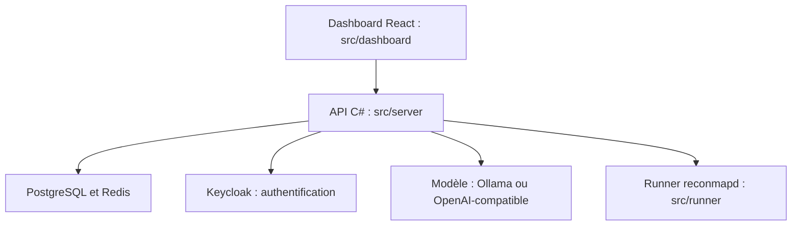

# reconmap/reconmap

> Plateforme qui planifie des scans de sécurité, trie les résultats avec un modèle de langage et rédige le rapport.

## Le problème
Les équipes qui mènent beaucoup de missions de sécurité perdent du temps à enchaîner les outils, trier les résultats et écrire les rapports.

## Ce que ça fait vraiment
À partir d'une cible, l'IA choisit des outils dans ton catalogue de commandes et met le scan en file. Des exécuteurs lancent les commandes sur tes machines. Des analyseurs lisent SARIF, CycloneDX, Nmap, Testssl, Subfinder, et un analyseur LLM prend le reste. Chaque résultat est évalué, puis exporté en Word, Markdown ou HTML. Un serveur MCP est fourni.

## Comment c'est branché


## Essayer
```sh
docker compose up -d
```
Puis ouvrir http://localhost:5500.

## Coût et pièges
Docker et Docker Compose. Un modèle est nécessaire : Ollama en local, ou Azure OpenAI, OpenRouter, avec facture à ta charge. Version hébergée sur netfoe.com.

## Ce que ce n'est pas
Ce n'est pas un scanner : il orchestre des outils que tu installes. Les verdicts de l'IA restent à vérifier.

## Alternatives
Aucune alternative nommée dans le README.

## Pour toi
À surveiller : exemple concret d'agent qui orchestre des outils avec un modèle local, utile si ton équipe fait de la sécurité.

