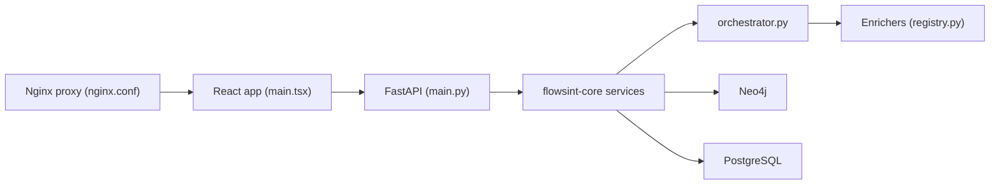

# reconurge/flowsint

> Self-hosted OSINT investigation platform using an entity graph and automatic enrichers, for analysts and journalists.

## The problem
OSINT investigations scatter domains, IPs, emails and social accounts across separate tools, with no relational view.

## What it actually does
You model entities in a graph (Neo4j), then run enrichers (DNS, WHOIS, subdomains, Maigret, email/phone leaks, crypto, site crawl) via Celery and Redis. Third-party API keys are encrypted in a vault. The React interface displays the graph with real-time SSE. A chat can go through OpenAI or Mistral.

## How it is wired


## Trying it
```bash
git clone https://github.com/reconurge/flowsint.git
cd flowsint
make prod
# puis http://localhost:5173/register
```

## Cost and gotchas
Docker and Make required; the stack bundles PostgreSQL, Neo4j and Redis. Before exposing on a network: change `AUTH_SECRET`, `MASTER_VAULT_KEY_V1`, `NEO4J_PASSWORD` and the host list in `nginx.conf`. The README's tests are said to be incomplete.

## What it is not
Not a surveillance tool: the README forbids doxxing, harassment and unauthorized collection (see ETHICS.md). The leak enrichers touch personal data: the legal framework is your responsibility.

## Alternatives
No alternative named in the README.

## For you
Watch: an entity graph with Celery orchestration is instructive, but OSINT is outside the data/AI core and the four-service stack is heavy.
