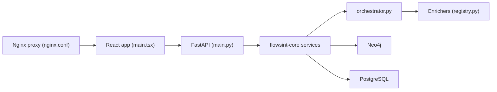

# reconurge/flowsint

> Plateforme auto-hébergée d'investigation OSINT par graphe d'entités et enrichisseurs automatiques, pour analystes et journalistes.

## Le problème
Les enquêtes OSINT dispersent domaines, IP, e-mails et comptes sociaux dans des outils séparés, sans vue relationnelle.

## Ce que ça fait vraiment
Tu modélises des entités dans un graphe (Neo4j), puis lances des enrichisseurs (DNS, WHOIS, sous-domaines, Maigret, fuites e-mail/téléphone, crypto, crawl de site) via Celery et Redis. Les clés d'API tierces sont chiffrées dans un coffre. L'interface React affiche le graphe avec SSE en temps réel. Un chat peut passer par OpenAI ou Mistral.

## Comment c'est branché


## Essayer
```bash
git clone https://github.com/reconurge/flowsint.git
cd flowsint
make prod
# puis http://localhost:5173/register
```

## Coût et pièges
Docker et Make requis ; la pile embarque PostgreSQL, Neo4j et Redis. Avant d'exposer sur un réseau : changer `AUTH_SECRET`, `MASTER_VAULT_KEY_V1`, `NEO4J_PASSWORD` et la liste d'hôtes dans `nginx.conf`. Les tests du README sont dits incomplets.

## Ce que ce n'est pas
Pas un outil de surveillance : le README interdit doxxing, harcèlement et collecte non autorisée (voir ETHICS.md). Les enrichisseurs de fuites touchent à des données personnelles : le cadre légal est à ta charge.

## Alternatives
Aucune alternative nommée dans le README.

## Pour toi
À surveiller : un graphe d'entités avec orchestration Celery est instructif, mais l'OSINT est hors du cœur data/IA et la pile à quatre services est lourde.

