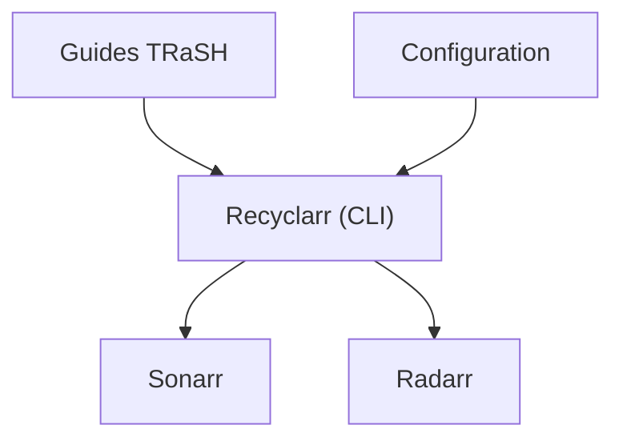

# recyclarr/recyclarr

> Command-line tool that syncs the settings of the TRaSH guides to Sonarr and Radarr.

## The problem
Maintaining quality profiles and custom formats by hand in Sonarr and Radarr does not keep up well with the evolution of the reference guides.

## What it actually does
Syncs to Radarr and Sonarr (v4 or later) the quality profiles, custom formats with scores, quality definitions (file sizes), naming formats and media management (propers/repacks), based on the TRaSH guides.

## How it is wired
Simplified diagram based on the fiche, no diagram supplied.

## Trying it
No command documented in the README: the Getting Started guide points to Docker installation.

## Cost and gotchas
Free. Requires existing Sonarr or Radarr instances. The Docker `latest` tag does not exist: use a major version tag (for example `8`).

## What it is not
Not a media manager: it downloads nothing, it configures Sonarr and Radarr.

## Alternatives
No alternative named in the README.

## For you
Ignore: a home media library tool, unrelated to data/AI/MLOps work.
