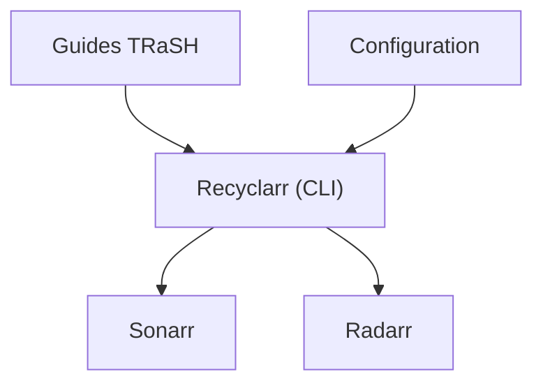

# recyclarr/recyclarr

> Outil en ligne de commande qui synchronise les réglages des guides TRaSH vers Sonarr et Radarr.

## Le problème
Maintenir à la main profils de qualité et formats personnalisés dans Sonarr et Radarr suit mal l'évolution des guides de référence.

## Ce que ça fait vraiment
Synchronise vers Radarr et Sonarr (v4 ou plus) les profils de qualité, formats personnalisés avec scores, définitions de qualité (tailles de fichiers), formats de nommage et gestion des médias (propers/repacks), à partir des guides TRaSH.

## Comment c'est branché
Schéma simplifié d'après la fiche, sans diagramme fourni.

## Essayer
Aucune commande documentée dans le README : le guide Getting Started renvoie à l'installation par Docker.

## Coût et pièges
Gratuit. Exige des instances Sonarr ou Radarr existantes. Le tag Docker `latest` n'existe pas : utiliser un tag de version majeure (par exemple `8`).

## Ce que ce n'est pas
Pas un gestionnaire de médias : il ne télécharge rien, il configure Sonarr et Radarr.

## Alternatives
Aucune alternative nommée dans le README.

## Pour toi
À ignorer : outil de médiathèque domestique, sans lien avec le travail data/IA/MLOps.

