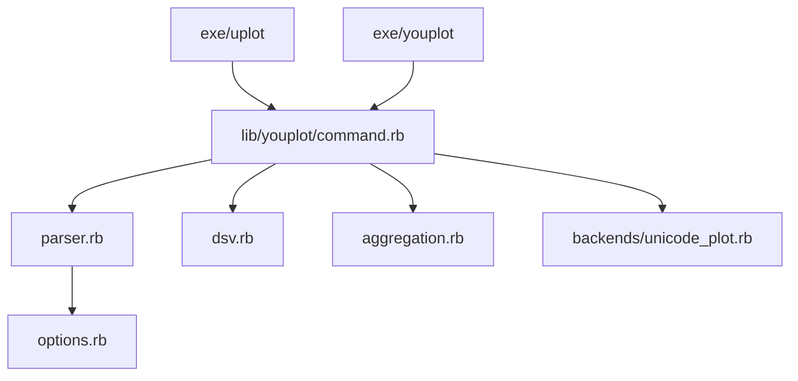

# red-data-tools/YouPlot

> Command-line tool that draws charts in the terminal from piped data.

## The problem
Taking a quick look at a distribution or a series coming out of a pipeline forces you to open Python or a spreadsheet.

## What it actually does
`uplot` reads data (stdin or files, configurable delimiter) and draws bars, histograms, lines, scatter plots, densities, box plots or counts, via UnicodePlot. It can pass the data through to the rest of the pipe (`-O`). An experimental progressive mode exists for live data. `count` is slow because it is written in Ruby.

## How it is wired


## Trying it
```bash
brew install youplot
gem install youplot
ps aux | awk '{print $1}' | uplot count
uplot hist --help
```

## Cost and gotchas
Free. Requires Ruby (`gem`) or a package manager; the Ruby requirement is not in the list of prerequisites. Time series are not handled.

## What it is not
Not a tool for publishable charts: the output is text. No simple support for categorical data, the README points to datamash.

## Alternatives
The README cites csvtk, GNU datamash, awk and xsv as complements, and YouPlot2 for a portable version without Ruby.

## For you
Adopt: a quick look at a CSV or a command output in the terminal, without leaving the shell or opening a notebook.
