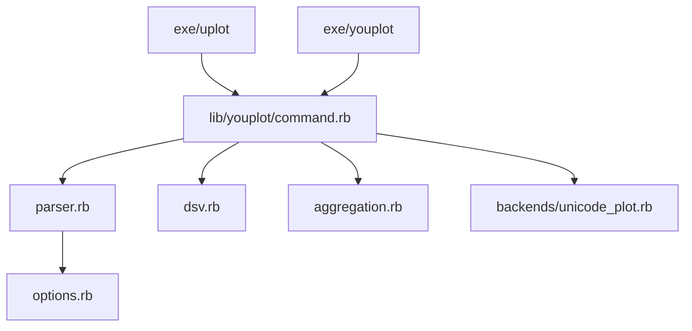

# red-data-tools/YouPlot

> Outil en ligne de commande qui trace des graphiques dans le terminal à partir de données en tube.

## Le problème
Jeter un œil à une distribution ou à une série sortie d'un pipeline oblige à ouvrir Python ou un tableur.

## Ce que ça fait vraiment
`uplot` lit des données (stdin ou fichiers, séparateur réglable) et dessine barres, histogrammes, courbes, nuages de points, densités, boîtes à moustaches ou comptages, via UnicodePlot. Il peut laisser passer les données vers la suite du tube (`-O`). Un mode progressif expérimental existe pour les données en direct. `count` est lent car écrit en Ruby.

## Comment c'est branché


## Essayer
```bash
brew install youplot
gem install youplot
ps aux | awk '{print $1}' | uplot count
uplot hist --help
```

## Coût et pièges
Gratuit. Demande Ruby (`gem`) ou un gestionnaire de paquets ; le besoin Ruby n'est pas dans la liste de prérequis. Les séries temporelles ne sont pas gérées.

## Ce que ce n'est pas
Pas un outil de graphiques publiables : le rendu est du texte. Pas de support des données catégorielles simple, le README renvoie à datamash.

## Alternatives
Le README cite csvtk, GNU datamash, awk et xsv comme compléments, et YouPlot2 pour une version portable sans Ruby.

## Pour toi
Adopter : un coup d'œil rapide sur un CSV ou une sortie de commande dans le terminal, sans quitter le shell ni ouvrir un notebook.

