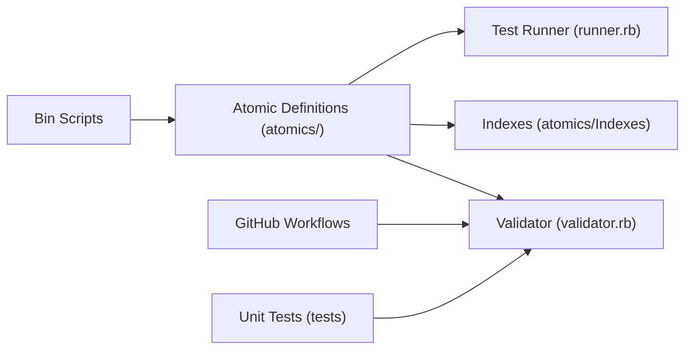

# redcanaryco/atomic-red-team

> Library of tests mapped to MITRE ATT&CK to check what a security team's defenses detect.

## The problem
A detection team does not know whether its tools actually catch adversary techniques. Without replayable tests tied to ATT&CK, coverage remains a guess.

## What it actually does
- An `atomics/` folder: one subfolder per ATT&CK technique (e.g. T1003.001), with YAML definitions and their Markdown documentation.
- Indexes (CSV, Markdown, JSON, YAML) in `atomics/Indexes` that link the tests to the techniques.
- A Ruby core (`atomic_red_team.rb`, `runner.rb`, `validator.rb`) and `bin/` scripts to validate the tests and generate the docs.
- Execution from the command line without installation, or through the Invoke-Atomic framework.

## How it is wired

## Trying it
No command is given in the README: it points to the "Getting started" page of the wiki, and to Invoke-Atomic for fuller execution.

## Cost and gotchas
Free, MIT license. The tests simulate adversary behavior: run them only on machines you are responsible for, preferably isolated, because the alerts they trigger are real.

## What it is not
- Not a vulnerability scanner nor a detection product: it provides tests, not verdicts.
- Not a full adversary emulation: each test is "atomic", isolated.
- The README does not describe the content of the tests; you have to read the wiki.

## Alternatives
The README names no alternative. It only mentions Invoke-Atomic, a complementary execution framework.

## For you
Adopt if you work on detection or the SOC (logs, SIEM rules): a recognized test base, MIT, backed by a company and active. Outside security, no interest.
