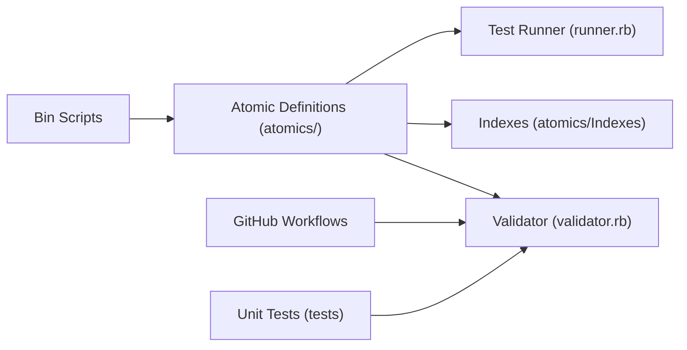

# redcanaryco/atomic-red-team

> Bibliothèque de tests mappés sur MITRE ATT&CK pour vérifier ce que détectent les défenses d'une équipe sécurité.

## Le problème
Une équipe de détection ne sait pas si ses outils repèrent réellement les techniques adverses. Sans tests rejouables et rattachés à ATT&CK, la couverture reste une supposition.

## Ce que ça fait vraiment
- Un dossier `atomics/` : un sous-dossier par technique ATT&CK (ex. T1003.001), avec des définitions YAML et leur documentation Markdown.
- Des index (CSV, Markdown, JSON, YAML) dans `atomics/Indexes` qui relient les tests aux techniques.
- Un cœur Ruby (`atomic_red_team.rb`, `runner.rb`, `validator.rb`) et des scripts `bin/` pour valider les tests et générer la doc.
- Exécution depuis la ligne de commande sans installation, ou via le framework Invoke-Atomic.

## Comment c'est branché

## Essayer
Aucune commande n'est donnée dans le README : il renvoie à la page « Getting started » du wiki, et à Invoke-Atomic pour une exécution plus complète.

## Coût et pièges
Gratuit, licence MIT. Les tests simulent des comportements adverses : à n'exécuter que sur des machines dont on est responsable, de préférence isolées, car les alertes qu'ils déclenchent sont réelles.

## Ce que ce n'est pas
- Pas un scanner de vulnérabilités ni un produit de détection : il fournit des tests, pas des verdicts.
- Pas une émulation complète d'adversaire : chaque test est « atomique », isolé.
- Le README ne décrit pas le contenu des tests ; il faut lire le wiki.

## Alternatives
Le README ne nomme aucune alternative. Il cite seulement Invoke-Atomic, framework d'exécution complémentaire.

## Pour toi
Adopter si tu touches à la détection ou au SOC (journaux, règles SIEM) : base de tests reconnue, MIT, soutenue par une société et active. Hors sécurité, aucun intérêt.

