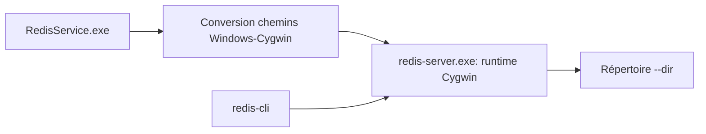

# redis-windows/redis-windows

> Redis builds compiled for Windows, with a service wrapper, for local development.

## The problem
Redis is not shipped natively for Windows.

## What it actually does
Binaries compiled from the official sources via MSYS2/Cygwin. `RedisService.exe` (.NET 10 wrapper) launches Redis or installs it as a Windows service and converts Windows paths to Cygwin paths; running `redis-server.exe` directly requires `/cygdrive/...` paths.

## How it is wired


## Trying it
```cmd
RedisService.exe run --foreground --port 6379 --dir C:\redis-data
RedisService.exe install -c C:\config\redis.conf --dir D:\data\redis --port 6379
net start Redis
```

## Cost and gotchas
Free. Always pass `--dir` and shut down cleanly (`redis-cli SHUTDOWN`), otherwise data is lost.

## What it is not
Not a Redis Ltd. product: unaffiliated. Recommended for local dev only, not production.

## Alternatives
Official Redis on Linux, recommended by the README for production.

## For you
Ignore, unless you are on a Windows machine without WSL: take Redis on Linux or Docker for any serious use.
