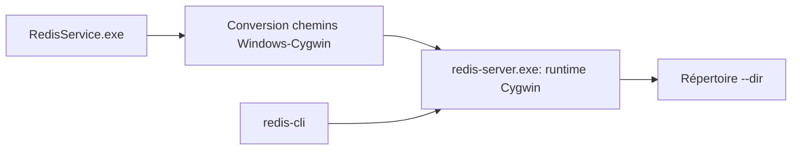

# redis-windows/redis-windows

> Builds de Redis compilés pour Windows, avec un service wrapper, pour le développement local.

## Le problème
Redis n'est pas fourni nativement pour Windows.

## Ce que ça fait vraiment
Binaires compilés depuis les sources officielles via MSYS2/Cygwin. `RedisService.exe` (wrapper .NET 10) lance Redis ou l'installe comme service Windows et convertit les chemins Windows en chemins Cygwin ; `redis-server.exe` direct exige des chemins `/cygdrive/...`.

## Comment c'est branché


## Essayer
```cmd
RedisService.exe run --foreground --port 6379 --dir C:\redis-data
RedisService.exe install -c C:\config\redis.conf --dir D:\data\redis --port 6379
net start Redis
```

## Coût et pièges
Gratuit. Toujours passer `--dir` et arrêter proprement (`redis-cli SHUTDOWN`) sinon les données sont perdues.

## Ce que ce n'est pas
Pas un produit de Redis Ltd. : non affilié. Recommandé pour le dev local seulement, pas la production.

## Alternatives
Redis officiel sous Linux, recommandé par le README pour la production.

## Pour toi
Ignorer, sauf poste Windows sans WSL : prends Redis sous Linux ou Docker pour tout usage sérieux.

