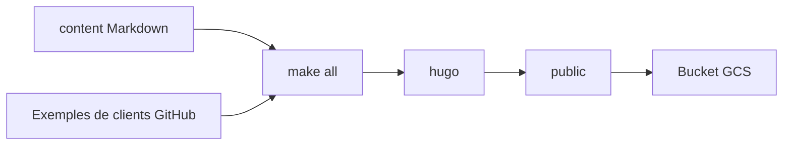

# redis/docs

> Sources of the official Redis documentation site, built with Hugo, for contributors.

## The problem
Maintaining product documentation at scale requires a reproducible site, with checked links and examples pulled from other repositories.

## What it actually does
The repository contains the Markdown pages (`/content`), the Hugo templates, Tailwind and the data. Every merge into `main` builds and publishes the site. The build fetches client examples from external GitHub repositories. The README mostly describes Hugo conventions.

## How it is wired
Simplified diagram based on the sheet, no diagram provided.



## Trying it
```bash
make all
make serve
hugo serve
```

## Cost and gotchas
Python 3.8 or later, Node 19.7 or later, extended Hugo 0.143, make and git. Publishing goes through a Google Cloud bucket reserved for maintainers.

## What it is not
It is not Redis code nor a tutorial: these are the site's sources. The license is not recognized by GitHub.

## Alternatives
No alternative named in the README.

## For you
Watch: worth reading to fix the Redis docs; otherwise it is the published site that is useful, not this repository.
