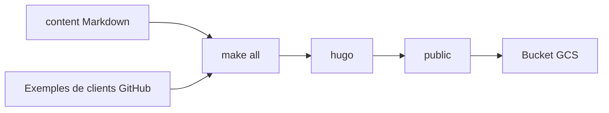

# redis/docs

> Sources du site de documentation officielle de Redis, construit avec Hugo, pour les contributeurs.

## Le problème
Maintenir une documentation produit à grande échelle demande un site reproductible, avec liens vérifiés et exemples tirés d'autres dépôts.

## Ce que ça fait vraiment
Le dépôt contient les pages Markdown (`/content`), les gabarits Hugo, Tailwind et les données. Chaque fusion dans `main` construit et publie le site. Le build récupère des exemples de clients depuis des dépôts GitHub externes. Le README décrit surtout les conventions Hugo.

## Comment c'est branché
Schéma simplifié d'après la fiche, sans diagramme fourni.



## Essayer
```bash
make all
make serve
hugo serve
```

## Coût et pièges
Python 3.8 ou plus, Node 19.7 ou plus, Hugo 0.143 étendu, make et git. La publication passe par un bucket Google Cloud réservé aux mainteneurs.

## Ce que ce n'est pas
Ce n'est pas du code Redis ni un tutoriel : ce sont les sources du site. La licence n'est pas reconnue par GitHub.

## Alternatives
Aucune alternative nommée dans le README.

## Pour toi
Surveiller : à lire pour corriger la doc Redis, sinon c'est le site publié qui sert, pas ce dépôt.

