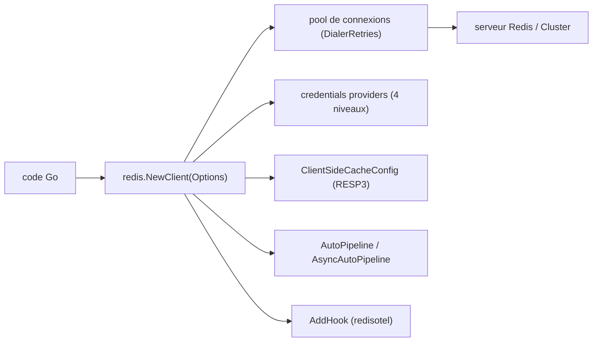

# redis/go-redis

> The official Redis client for Go, with pooling, cluster and client-side caching.

## The problem
Talking to Redis from Go takes more than a socket: connection pool, RESP2/RESP3, cluster,
sentinels, retries, and authentication that can rotate during the connection's lifetime.

## What it actually does
All commands except QUIT and SYNC, automatic pooling, Pub/Sub, pipelines and transactions,
scripting, Sentinel, Cluster. Four credential sources in priority order, from
`StreamingCredentialsProvider` (experimental, for Entra ID) to the `Username`/`Password` fields.
Client-side cache bounded by `ClientSideCacheConfig`, invalidated by RESP3 notifications.
Experimental automatic pipelining, in blocking (`AutoPipeline`) and deferred
(`AsyncAutoPipeline`) versions. Typed error functions (`IsLoadingError`, `IsOOMError`, `IsMovedError`...).

## How it is wired


## Trying it
```bash
go mod init github.com/my/repo
go get github.com/redis/go-redis/v9
```
```go
rdb := redis.NewClient(&redis.Options{Addr: "localhost:6379", Protocol: 3})
defer rdb.Close()
err := rdb.Set(ctx, "key", "value", 0).Err()
```

## Cost and gotchas
The client-side cache requires RESP3, a standalone client and database 0, and rejects `SELECT`, `AUTH`,
`RESET`, `CLIENT TRACKING` — a forbidden command makes its whole pipeline fail. With autopipelining,
a command's context is no longer honored once it is queued, and a batch replayed after a disconnect
can execute a non-idempotent command twice. `Do` is the wrong tool for any command
that changes session state: use `client.Conn()`.

## What it is not
Not a server nor a standalone local cache. Several surfaces are explicitly experimental —
the `AR*` array type (Redis 8.8+), autopipelining, client cache, streaming credentials — and the README
asks you to pin the version if you adopt them. `UnstableResp3` has become a no-op.

## Alternatives
- `go-redis-entraid`: the named extension for Entra ID authentication.

## For you
The reference client if one of your services is in Go; leave the experimental options aside.
