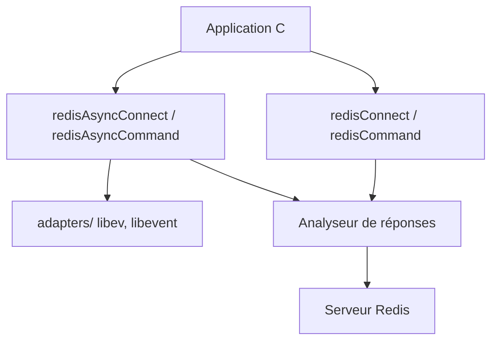

# redis/hiredis

> Minimalist C client for Redis, with synchronous and asynchronous APIs and a reply parser.

## The problem
Talking to Redis from C requires implementing the protocol and parsing replies without going through a heavy client.

## What it actually does
Sends commands with a printf-like format, reads RESP2 and RESP3 replies and handles pipelining. The asynchronous API adapts to event loops such as libev or libevent. The reply parser is separate from I/O so it can serve as a base for other languages. A context is not thread-safe.

## How it is wired
Simplified diagram based on the fiche, no diagram provided.



## Trying it
```c
redisContext *c = redisConnect("127.0.0.1", 6379);
reply = redisCommand(context, "SET foo bar");
freeReplyObject(reply);
redisFree(c);
```

## Cost and gotchas
No cost. Do not free replies in asynchronous mode. Breaking changes exist between versions (0.14, 1.0). README truncated in the material provided.

## What it is not
Not a high-level client with one method per command. Not thread-safe.

## Alternatives
No alternative named in the part of the README that was read.

## For you
Worth watching: a useful base if you write C or a binding, but in Python or Java you will go through a client in your own language.
