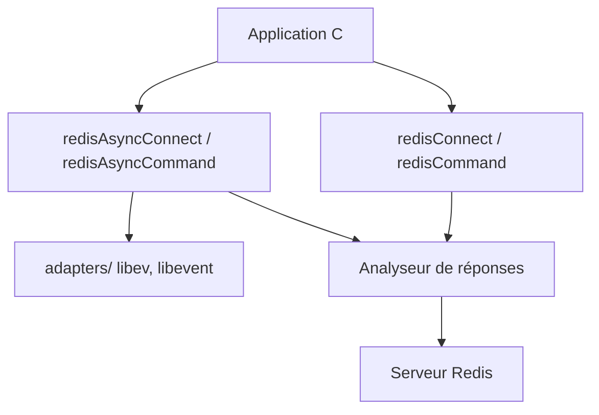

# redis/hiredis

> Client C minimaliste pour Redis, avec API synchrone, asynchrone et un analyseur de réponses.

## Le problème
Parler à Redis depuis du C demande d'implémenter le protocole et d'analyser les réponses sans passer par un client lourd.

## Ce que ça fait vraiment
Envoie des commandes avec un format de type printf, lit les réponses RESP2 et RESP3 et gère le pipelining. L'API asynchrone s'adapte à des boucles d'événements comme libev ou libevent. L'analyseur de réponses est séparé de l'entrée-sortie pour servir de base à d'autres langages. Un contexte n'est pas thread-safe.

## Comment c'est branché
Schéma simplifié d'après la fiche, sans diagramme fourni.



## Essayer
```c
redisContext *c = redisConnect("127.0.0.1", 6379);
reply = redisCommand(context, "SET foo bar");
freeReplyObject(reply);
redisFree(c);
```

## Coût et pièges
Aucun coût. Ne pas libérer les réponses en mode asynchrone. Des changements incompatibles existent entre versions (0.14, 1.0). README tronqué dans la matière fournie.

## Ce que ce n'est pas
Pas un client de haut niveau avec une méthode par commande. Pas thread-safe.

## Alternatives
Aucune alternative nommée dans la partie lue du README.

## Pour toi
À surveiller : base utile si tu écris du C ou un binding, mais en Python ou Java tu passeras par un client de ton langage.

