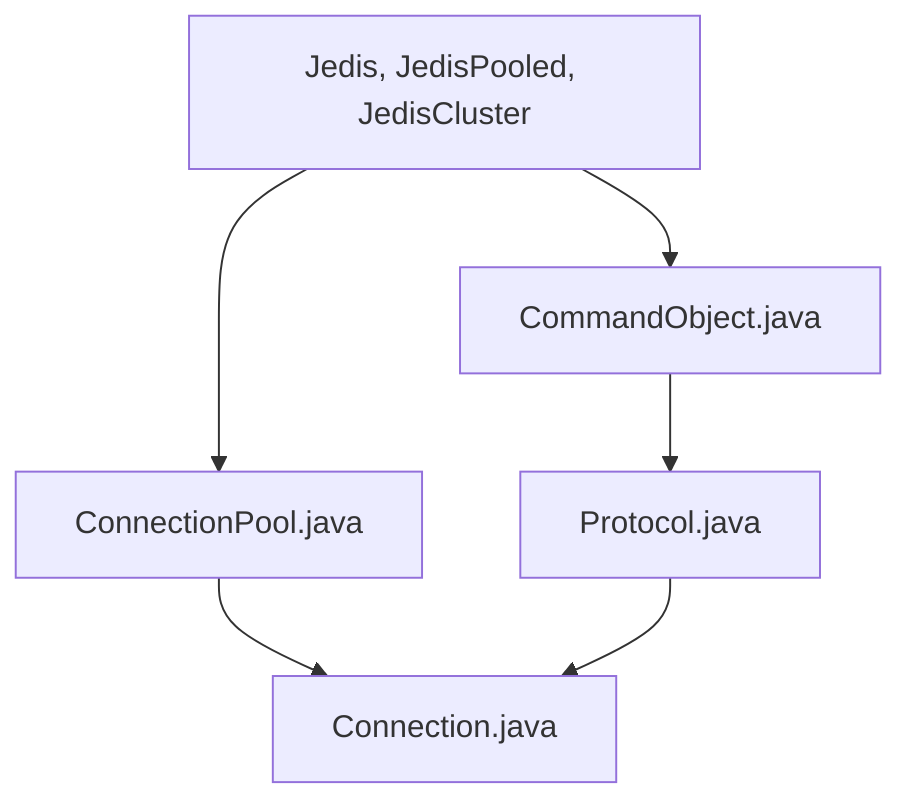

# redis/jedis

> Java client for Redis, focused on performance and simplicity, for Java developers.

## The problem
Talking to Redis from Java requires a client that handles pooling, clustering and failover.

## What it actually does
It provides clients (`RedisClient`, `RedisClusterClient`), connection pools, providers for sentinel and cluster, command objects, pipelines and transactions, plus support for Redis modules (JSON, search, Bloom, time series). It handles failover between deployments and token-based authentication (Microsoft EntraID).

## How it is wired


## Trying it
```bash
docker run -p 6379:6379 -it redis:latest
```
```java
RedisClient jedis = RedisClient.builder().hostAndPort("localhost", 6379).build();
jedis.sadd("planets", "Venus");
```

## Cost and gotchas
Free; a Redis server is required (the README suggests Docker). Maven dependency at version 8.0.1.

## What it is not
Not an object mapper: the README points to another library for that. Java only.

## Alternatives
redis-om-spring: a higher-level library with object mapping.

## For you
Ignore it: a Java client, unless your MLOps chain goes through Java; otherwise a Python client is more direct.
