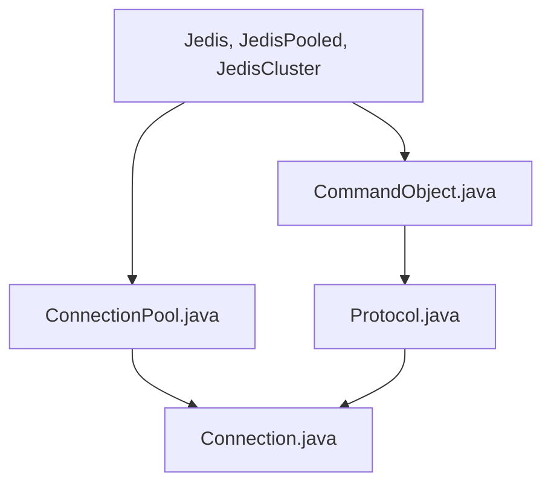

# redis/jedis

> Client Java pour Redis, orienté performance et simplicité, pour développeurs Java.

## Le problème
Parler à Redis depuis Java demande un client gérant pool, cluster et reprise sur panne.

## Ce que ça fait vraiment
Il fournit des clients (`RedisClient`, `RedisClusterClient`), des pools de connexions, des fournisseurs pour sentinelle et cluster, des objets de commande, pipelines et transactions, plus le support des modules Redis (JSON, recherche, Bloom, séries temporelles). Il gère le basculement entre déploiements et l'authentification par jeton (Microsoft EntraID).

## Comment c'est branché


## Essayer
```bash
docker run -p 6379:6379 -it redis:latest
```
```java
RedisClient jedis = RedisClient.builder().hostAndPort("localhost", 6379).build();
jedis.sadd("planets", "Venus");
```

## Coût et pièges
Gratuit ; il faut un serveur Redis (le README propose Docker). Dépendance Maven en version 8.0.1.

## Ce que ce n'est pas
Pas un mapping objet : le README oriente vers une autre bibliothèque pour cela. Uniquement Java.

## Alternatives
redis-om-spring : bibliothèque de plus haut niveau, avec mapping d'objets.

## Pour toi
À ignorer : client Java, sauf si ta chaîne MLOps passe par du Java ; sinon un client Python est plus direct.

