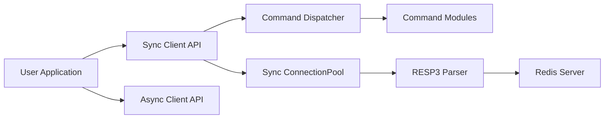

# redis/redis-py

> Official Python client for Redis, synchronous and asynchronous, with cluster and Sentinel support.

## The problem
Talking to Redis from Python (cache, queue, pub/sub, vector search) requires a reliable and complete client.

## What it actually does
All Redis commands under their own names, connection pool, pipelines (MULTI/EXEC), PubSub.
Async, cluster and Sentinel clients; RESP2/RESP3 parser, accelerated by hiredis if present.
Search commands (`ft()`) with dialect 2 by default since 6.0.
Multi-database client with automatic failover; bulk import HIMPORT (Redis 8.10).

## How it is wired


## Trying it
```bash
docker run -p 6379:6379 -it redis:latest
pip install redis
pip install "redis[hiredis]"
```

## Cost and gotchas
Free; a Redis server is required. Python 3.9+ since 6.2.0. The default search dialect may change your results.

## What it is not
Not an ORM: for object mapping, redis-om-python is recommended.

## Alternatives
- redis-om-python: higher-level object mapping, cited by the README.

## For you
Adopt as soon as an ML pipeline or service touches Redis (feature cache, queue, vectors): the reference client maintained by Redis Inc.
