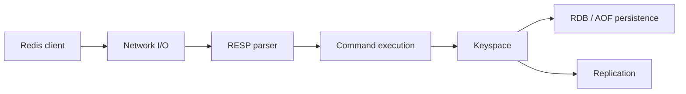

# redis/redis

> In-memory data structure server that functions as a cache, a key-value database, and a vector search engine.

## The problem
Real-time applications require very fast access to data (caching, sessions, queues), without relying on the main database.

## What it actually does
A client sends a command using the RESP protocol; the server processes it within the keyspace (strings, lists, sets, hashes, sorted sets, streams, JSON, time series) and responds. Persistence is achieved through RDB snapshots or AOF logging, replication, clustering, Lua scripts, functions, and pub/sub. Redis Search and vector sets cover vector search and semantic caching for RAG (Retrieval-Augmented Generation).

## How it is wired


## Trying it
```bash
docker run -d -p 6379:6379 redis:latest
cd src && ./redis-cli
```

## Cost and gotchas
Free for local use. Licensing by version: BSD up to 7.2, RSALv2 or SSPLv1 from 7.4 to 7.8, RSALv2/SSPLv1/AGPLv3 from 8.0. Intel SVS optimizations are incompatible with AGPL and SSPL. Full compilation requires significant resources (LLVM 21, Rust, CMake 3.25–3.31.6).

## What it is not
Not a default, permanent solution: data remains in memory first. Redis Cloud and Redis Software are separate, paid offerings.

## Alternatives
No alternative is specified in the README file.

## For you
To be adopted for caching, queues, and agent memory, while verifying the license of the chosen version.
