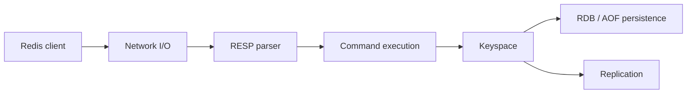

# redis/redis

> Serveur de structures de données en mémoire servant de cache, de base clé-valeur et de moteur de recherche vectorielle.

## Le problème
Les applications temps réel ont besoin d'un accès très rapide aux données (cache, sessions, files), sans solliciter la base principale.

## Ce que ça fait vraiment
Un client envoie une commande en protocole RESP ; le serveur l'exécute sur le keyspace (chaînes, listes, ensembles, hash, ensembles triés, streams, JSON, séries temporelles) et répond. Persistance par snapshots RDB ou journal AOF, réplication, cluster, scripts Lua, fonctions, pub/sub. Redis Search et les ensembles vectoriels couvrent la recherche vectorielle et le cache sémantique pour le RAG.

## Comment c'est branché


## Essayer
```bash
docker run -d -p 6379:6379 redis:latest
cd src && ./redis-cli
```

## Coût et pièges
Gratuit en local. Licences par version : BSD jusqu'à 7.2, RSALv2 ou SSPLv1 de 7.4 à 7.8, RSALv2/SSPLv1/AGPLv3 depuis 8.0. Les optimisations Intel SVS sont incompatibles avec AGPL et SSPL. Compilation complète exigeante (LLVM 21, Rust, CMake 3.25–3.31.6).

## Ce que ce n'est pas
Pas une base durable par défaut : les données restent d'abord en mémoire. Redis Cloud et Redis Software sont des offres payantes distinctes.

## Alternatives
Aucune alternative nommée dans le README.

## Pour toi
À adopter pour le cache, les files et la mémoire d'agents, en vérifiant la licence de la version retenue.

