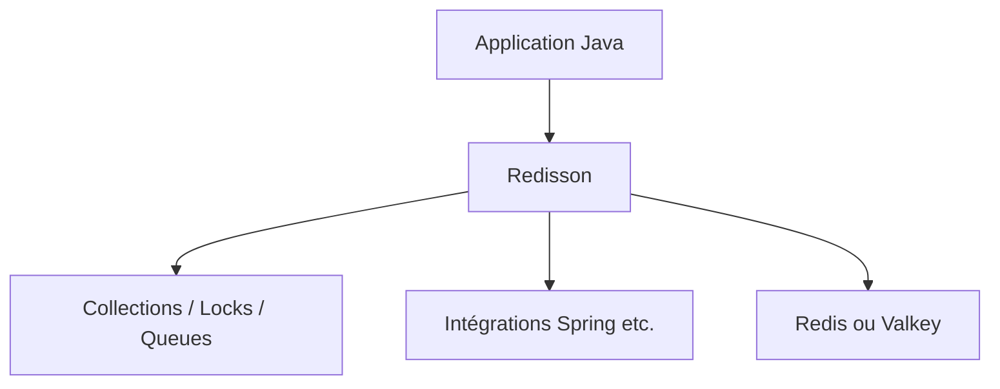

# redisson/redisson

> Java client for Redis and Valkey, with distributed collections, locks and services.

## The problem
Basic Redis clients don't offer ready-to-use distributed Java structures.

## What it actually does
Provides collections, locks, queues, rate limiters, Bloom filters, remote services and a scheduler on top of Redis 3.0+ and Valkey 7.2.5+. Spring, Hibernate, Quarkus, Micronaut, Tomcat integrations. Synchronous, asynchronous, Reactive and RxJava3 APIs. Over 2000 unit tests claimed.

## How it is wired


## Trying it
```bash
# Aucune commande documentée dans ce README : voir Quick start et Documentation.
```

## Cost and gotchas
Free for the library; a Redis or Valkey server is required. Any paid editions are not described in this README.

## What it is not
Not a Redis server, not a Python or JS client. README with no code example or license mention.

## Alternatives
Jedis, Lettuce and Spring Data Redis: compared in the README, Redisson extends them.

## For you
Ignore if your data / AI stack is not Java: it is a JVM client, of no direct interest for Python.
