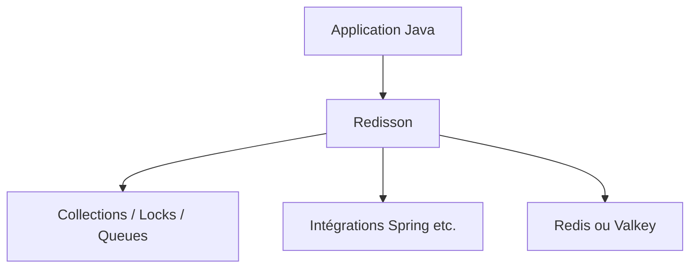

# redisson/redisson

> Client Java pour Redis et Valkey, avec collections, verrous et services distribués.

## Le problème
Les clients Redis de base n'offrent pas de structures Java distribuées prêtes à l'emploi.

## Ce que ça fait vraiment
Fournit des collections, verrous, files, limiteurs de débit, filtres de Bloom, services distants et planificateur au-dessus de Redis 3.0+ et Valkey 7.2.5+. Intégrations Spring, Hibernate, Quarkus, Micronaut, Tomcat. API synchrone, asynchrone, Reactive et RxJava3. Plus de 2000 tests unitaires annoncés.

## Comment c'est branché


## Essayer
```bash
# Aucune commande documentée dans ce README : voir Quick start et Documentation.
```

## Coût et pièges
Gratuit pour la bibliothèque ; il faut un serveur Redis ou Valkey. Les éventuelles éditions payantes ne sont pas décrites dans ce README.

## Ce que ce n'est pas
Pas un serveur Redis, pas un client Python ou JS. README sans exemple de code ni mention de licence.

## Alternatives
Jedis, Lettuce et Spring Data Redis : comparés dans le README, Redisson les étend.

## Pour toi
À ignorer si ton stack data / IA n'est pas en Java : c'est un client JVM, sans intérêt direct pour Python.

