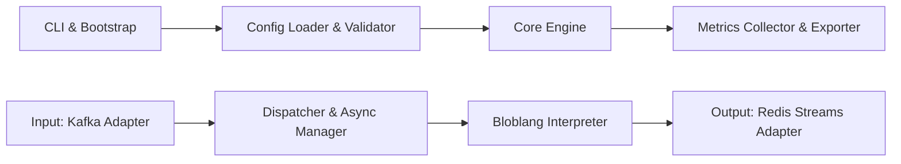

# redpanda-data/connect

> Single-binary stream processor that links sources and destinations through declarative YAML pipelines.

## The problem
Moving and transforming data between databases, brokers and cloud storage means coding and operating custom connectors.

## What it actually does
A YAML file describes `input`, processors and `output`; the Go binary runs in a container or standalone. Broad catalog (Kafka, NATS, AWS, GCP, Azure, SQL, MongoDB, HTTP…), CDC for Postgres, MySQL, MongoDB, Oracle, MSSQL, Iceberg output. Transformations in Bloblang. At-least-once delivery with no disk state. `/ping` and `/ready` probes, Prometheus/Statsd metrics, OpenTelemetry traces. Go plugins possible.

## How it is wired


## Trying it
```bash
brew install redpanda-data/tap/redpanda
docker pull docker.redpanda.com/redpandadata/connect
rpk connect run ./config.yaml
task build:all
```

## Cost and gotchas
Free binary; GitHub identifies no license for this repository, to be checked (some components may fall under Redpanda terms). Connectors with C dependencies are excluded without the `x_benthos_extra` tag.

## What it is not
Not a broker nor a stateful compute engine (no persisted aggregated windows): it transports and transforms message by message.

## Alternatives
No alternative named in the README.

## For you
Worth watching: Postgres-to-Iceberg CDC in a single YAML is very useful for a data pipeline, but the absence of a declared license means the terms must be clarified before any enterprise use.
