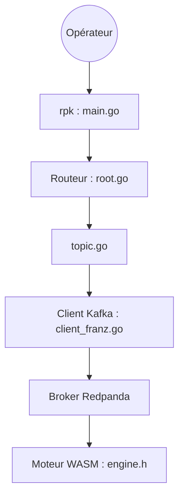

# redpanda-data/redpanda

> Kafka-compatible data streaming platform, without ZooKeeper or the JVM, for data and platform teams.

## The problem
Running Kafka is heavy: ZooKeeper, the JVM, many components to hold together.

## What it actually does
A C++ broker compatible with the Kafka API, with tiered storage, a schema registry and WASM transformations. The `rpk` command-line tool (Go) drives topics, cluster, security, cloud, connectors and transformations through the Kafka and Admin clients.

## How it is wired


## Trying it
```bash
curl -1sLf 'https://linux.pkg.redpanda.com/setup-redpanda.deb.sh' | sudo -E bash
sudo apt-get install redpanda
# macOS (Docker requis)
brew install redpanda-data/tap/redpanda && rpk container start
```

## Cost and gotchas
Free via the provided packages; Docker is required on macOS. Heavy Bazel build. Release candidates are not for production.

## What it is not
Not a simple library: it is a server you have to operate. The license is missing on the catalog side; read it in the repository before use.

## Alternatives
Apache Kafka: the reference it aims to be compatible with, with an older ecosystem.

## For you
Worth watching: relevant if you feed streaming pipelines, but the undeclared license requires a check.
