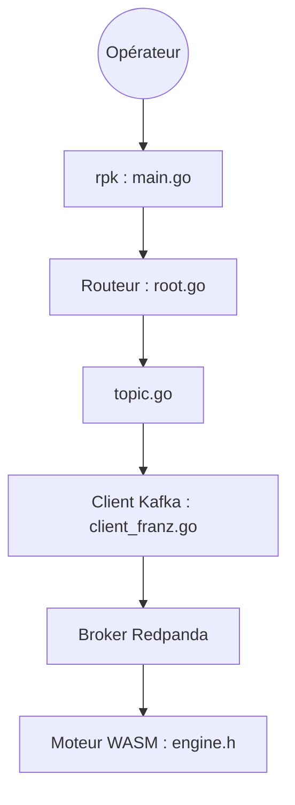

# redpanda-data/redpanda

> Plateforme de streaming de données compatible Kafka, sans ZooKeeper ni JVM, pour équipes data et plateforme.

## Le problème
Exploiter Kafka est lourd : ZooKeeper, JVM, nombreux composants à faire tenir ensemble.

## Ce que ça fait vraiment
Un broker C++ compatible avec l'API Kafka, avec stockage hiérarchisé, schema registry et transformations WASM. L'outil en ligne de commande `rpk` (Go) pilote topics, cluster, sécurité, cloud, connecteurs et transformations via les clients Kafka et Admin.

## Comment c'est branché


## Essayer
```bash
curl -1sLf 'https://linux.pkg.redpanda.com/setup-redpanda.deb.sh' | sudo -E bash
sudo apt-get install redpanda
# macOS (Docker requis)
brew install redpanda-data/tap/redpanda && rpk container start
```

## Coût et pièges
Gratuit via les paquets fournis ; Docker obligatoire sur macOS. Compilation par Bazel lourde. Les versions candidates ne sont pas pour la production.

## Ce que ce n'est pas
Pas une simple bibliothèque : c'est un serveur à exploiter. La licence est absente côté catalogue, à lire dans le dépôt avant usage.

## Alternatives
Apache Kafka : référence dont il se veut compatible, avec un écosystème plus ancien.

## Pour toi
À surveiller : pertinent si tu alimentes des pipelines en flux, mais la licence non déclarée impose une vérification.

