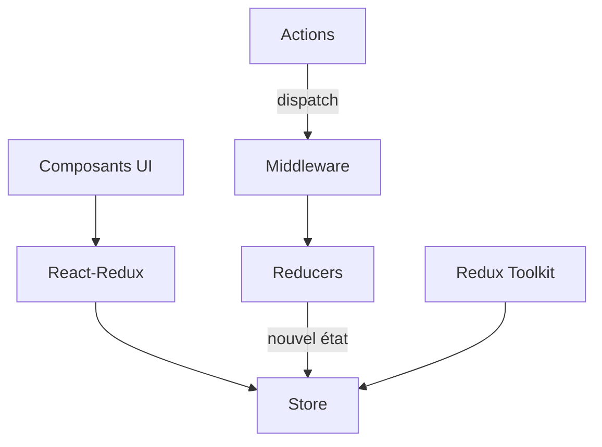

# reduxjs/redux

> JavaScript library for predictable global state management, for front-end applications.

## The problem
In a large interface, state scattered across components becomes inconsistent and hard to test.

## What it actually does
A single store holds the state; you change it by sending actions to reducers, pure functions that compute the new state. The core weighs 2 kB. Redux Toolkit, the recommended option, simplifies writing (createSlice, configureStore) with Immer. Works with React or any other view layer.

## How it is wired


## Trying it
```bash
npx tiged reduxjs/redux-templates/packages/vite-template-redux my-app
npx create-next-app --example with-redux my-app
npm install @reduxjs/toolkit react-redux
npm install redux
```

## Cost and gotchas
Free. The learning curve and repetitive code were well known; Redux Toolkit reduces them. The README asks you to consider whether Redux is necessary.

## What it is not
Not a data-fetching tool. Not mandatory: the README urges not to use it without need.

## Alternatives
No alternative named, apart from the "You Might Not Need Redux" page.

## For you
Ignore: UI state management unrelated to data, unless you are building a React dashboard.
