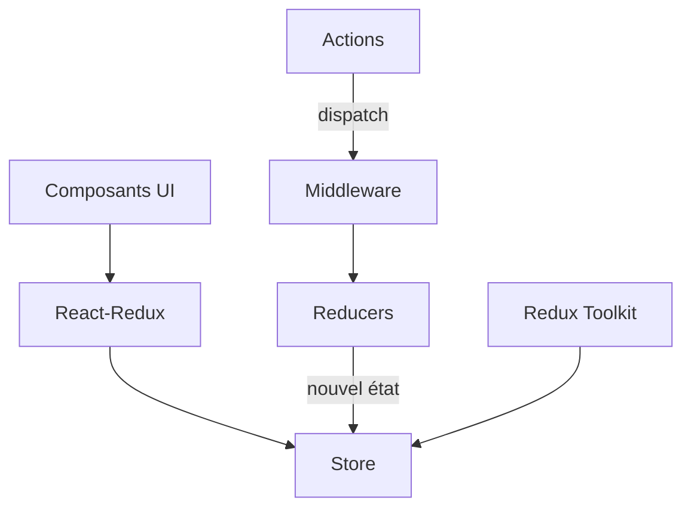

# reduxjs/redux

> Bibliothèque JavaScript de gestion d'état global prévisible, pour applications front-end.

## Le problème
Dans une grande interface, l'état dispersé entre composants devient incohérent et difficile à tester.

## Ce que ça fait vraiment
Un store unique contient l'état ; on le modifie en envoyant des actions à des reducers, fonctions pures qui calculent le nouvel état. Le noyau pèse 2 ko. Redux Toolkit, recommandé, simplifie l'écriture (createSlice, configureStore) avec Immer. Fonctionne avec React ou toute autre vue.

## Comment c'est branché


## Essayer
```bash
npx tiged reduxjs/redux-templates/packages/vite-template-redux my-app
npx create-next-app --example with-redux my-app
npm install @reduxjs/toolkit react-redux
npm install redux
```

## Coût et pièges
Gratuit. La courbe d'apprentissage et le code répétitif étaient connus ; Redux Toolkit les réduit. Le README demande de se demander si Redux est nécessaire.

## Ce que ce n'est pas
Pas un outil de récupération de données. Pas obligatoire : le README invite à ne pas l'utiliser sans besoin.

## Alternatives
Aucune alternative nommée, hormis la page « You Might Not Need Redux ».

## Pour toi
À ignorer : gestion d'état d'interface sans rapport avec la data, sauf si tu construis un tableau de bord React.

