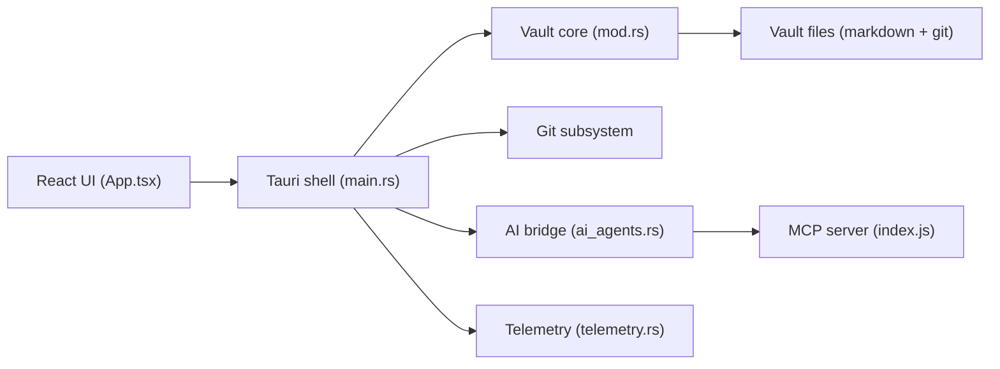

# refactoringhq/tolaria

> Desktop and mobile application to manage a Markdown knowledge base versioned with git.

## The problem
Notes live in proprietary applications or the cloud, with no git history and no clean access for AI agents.

## What it actually does
Each vault is a git repository of Markdown files with YAML frontmatter. Dual editor (rich BlockNote and raw Markdown), wikilinks, views, local search, command palette. AI panel connected to Claude Code, Codex CLI or Gemini CLI through a local MCP bridge. No account and no central server. iOS in TestFlight beta.

## How it is wired


## Trying it
```bash
brew install --cask tolaria
# ou, depuis les sources :
pnpm install
pnpm dev
pnpm tauri dev
```

## Cost and gotchas
Free. The MCP server launches the system `node` on Linux. The README mentions optional telemetry and update services without detailing their content. A build from source requires Node 20+, pnpm 8+ and Rust.

## What it is not
Not a synced service: syncing relies on git or iCloud. Types are only navigation aids, with no enforced schema. Mobile remains in beta.

## Alternatives
No alternative named in the README.

## For you
Watch: the "git vault readable by an agent" idea fits an AI workflow, but the AGPL-3.0, a single main author and the telemetry need checking before team use.
