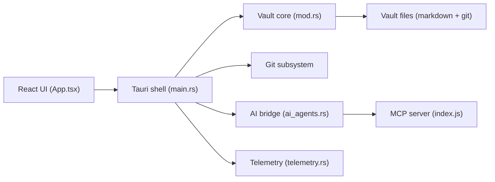

# refactoringhq/tolaria

> Application de bureau et mobile pour gérer une base de connaissances en Markdown versionnée avec git.

## Le problème
Les notes vivent dans des applications propriétaires ou le cloud, sans historique git ni accès propre pour des agents IA.

## Ce que ça fait vraiment
Chaque coffre est un dépôt git de fichiers Markdown avec frontmatter YAML. Éditeur double (riche BlockNote et Markdown brut), wikilinks, vues, recherche locale, palette de commandes. Panneau IA branché sur Claude Code, Codex CLI ou Gemini CLI via un pont MCP local. Aucun compte ni serveur central. iOS en bêta TestFlight.

## Comment c'est branché


## Essayer
```bash
brew install --cask tolaria
# ou, depuis les sources :
pnpm install
pnpm dev
pnpm tauri dev
```

## Coût et pièges
Gratuit. Le serveur MCP lance le `node` système sous Linux. Le README mentionne des services de télémétrie et de mise à jour optionnels sans détailler leur contenu. Un build depuis les sources demande Node 20+, pnpm 8+ et Rust.

## Ce que ce n'est pas
Pas un service synchronisé : la synchro repose sur git ou iCloud. Les types ne sont que des aides de navigation, sans schéma imposé. Le mobile reste en bêta.

## Alternatives
Aucune alternative nommée dans le README.

## Pour toi
À surveiller : l'idée « vault git lisible par agent » colle à un flux IA, mais l'AGPL-3.0, un auteur principal et la télémétrie sont à vérifier avant un usage d'équipe.

