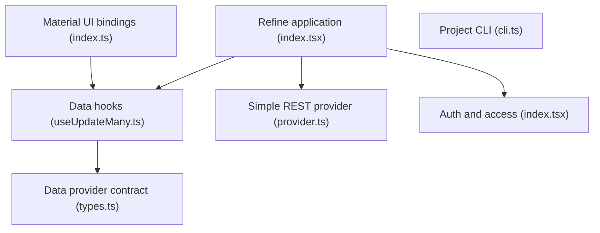

# refinedev/refine

> React framework for admin and data-entry (CRUD) applications, to be wired to your own APIs.

## The problem
Internal tools and CRUD dashboards need the same authentication, routing and data-access code.

## What it actually does
The README contains only a file path (`packages/core/README.md`): insufficient material. The architecture shows data hooks connected to providers (simple REST, GraphQL, Supabase, Appwrite), UI bindings (Ant Design, Material UI, Chakra UI), authentication, routing, internationalization, Devtools and a generation CLI.

## How it is wired

## Trying it
Not documented in the README provided.

## Cost and gotchas
Not documented. The framework is free according to the catalog's MIT license.

## What it is not
Not a data visualization or ML tool. Many links between packages are not verified in the diagram.

## Alternatives
No alternative named in the README.

## For you
Can help quickly build an annotation or admin interface around an ML back end, but the material is too thin to decide further: keep an eye on it.
