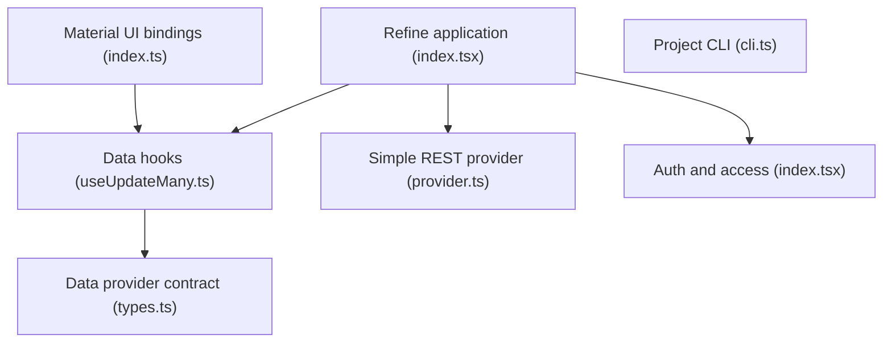

# refinedev/refine

> Cadre React pour applications d'administration et de saisie de données (CRUD), à relier à ses propres API.

## Le problème
Les outils internes et tableaux de bord CRUD demandent le même code d'authentification, de routage et d'accès aux données.

## Ce que ça fait vraiment
Le README ne contient qu'un chemin de fichier (`packages/core/README.md`) : matière insuffisante. L'architecture indique des hooks de données reliés à des fournisseurs (REST simple, GraphQL, Supabase, Appwrite), des liaisons d'interface (Ant Design, Material UI, Chakra UI), authentification, routage, internationalisation, Devtools et une CLI de génération.

## Comment c'est branché

## Essayer
Non documenté dans le README fourni.

## Coût et pièges
Non documenté. Le framework est gratuit d'après la licence MIT du catalogue.

## Ce que ce n'est pas
Pas un outil de visualisation de données ni de ML. Beaucoup de liens entre paquets ne sont pas vérifiés dans le diagramme.

## Alternatives
Aucune alternative nommée dans le README.

## Pour toi
Peut servir à monter vite une interface d'annotation ou d'administration autour d'un back-end ML, mais la matière est trop mince pour trancher plus : à surveiller.

