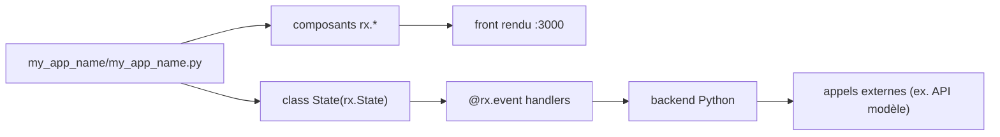

# reflex-dev/reflex

> Write a complete web application, front and back, in Python alone.

## The problem
Exposing a Python model or process means learning a JavaScript framework on top.
Splitting front and back for a simple demo multiplies code and deployments.

## What it actually does
The interface is described in Python (`rx.vstack`, `rx.input`, `rx.button`, `rx.image`); state lives in an `rx.State` class.
Event handlers are methods decorated with `@rx.event`, including async ones, with `yield` for intermediate rendering.
Fast reload: source changes are visible immediately, and the app runs on `localhost:3000`.
Around it: an AI Builder that generates applications, an Agent Toolkit (MCP and skills) and a deployment service.

## How it is wired


## Trying it
```bash
mkdir my_app_name
cd my_app_name
uv init
uv add reflex
uv run reflex init
uv run reflex run
```

## Cost and gotchas
The library is free; the AI Builder, app management and deployment are the vendor's services.
A virtual environment is strongly recommended, otherwise the `reflex` command may not be on your PATH.
The example calls an OpenAI image model: that part is billed.

## What it is not
It is not Python running in the browser: the real architecture is deferred to a documentation page, not described here.
It is not a notebook or a dashboard tool: it is an application framework, with the maintenance that implies.
The README is very short and states neither version requirements nor a license.

## Alternatives
No alternative named in the README.

## For you
The reasonable choice when a Streamlit demo is no longer enough but a real TypeScript front end would be overkill.
