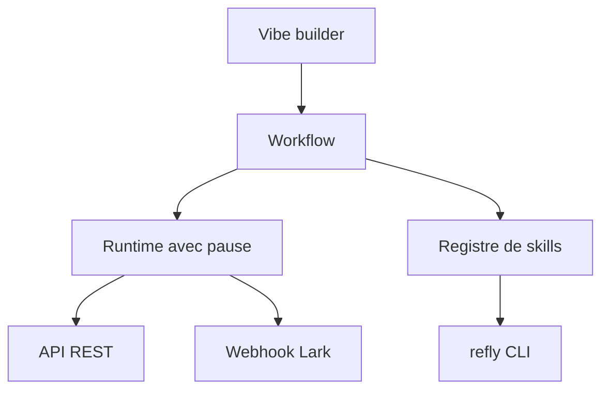

# refly-ai/refly

> Open-source platform to build versioned agent skills and export them as an API, webhook or Claude Code skill.

## The problem
Agent workflows are fragile scripts, hard to reuse from one runtime to another.

## What it actually does
A visual workflow editor with a "vibe" mode (you describe in natural language). A workflow runs from the interface, via REST API or via webhook (Lark/Feishu). A skill registry with a CLI allows installation and publishing. MCP integration announced; native export to Claude Code and Cursor is marked "coming soon".

## How it is wired

Diagram not provided: simplified diagram based on the README.

## Trying it
```bash
npm install -g @powerformer/refly-cli
refly skill install <skill-id>
npx skills add refly-ai/<skill-name>
refly skill publish <skill-id>
```

## Cost and gotchas
Self-hosting with Docker (separate guide), local port 5700. You must configure a model provider with its key.

## What it is not
Not yet a complete Claude Code export. The README's figures ("100% reliability") are unverifiable marketing.

## Alternatives
- n8n, Dify: established visual orchestration, but less oriented toward reusable skills.
- LangChain: code primitives rather than an interface.

## For you
Worth watching: the skill registry idea is relevant, but several features are announced and not delivered.
