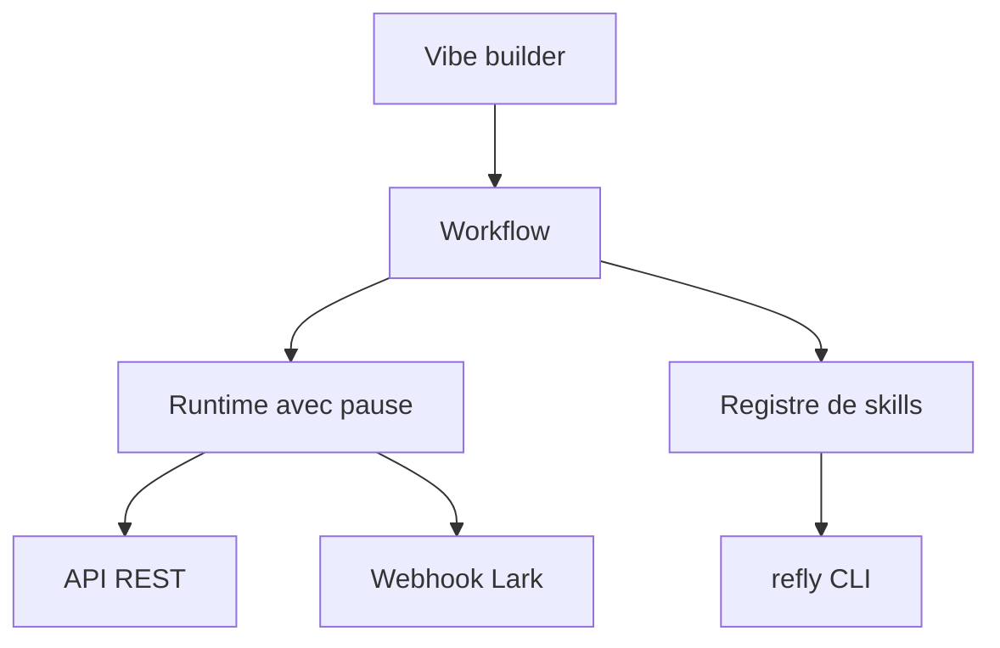

# refly-ai/refly

> Plateforme open source pour construire des skills d'agents versionnés et les exporter en API, webhook ou skill Claude Code.

## Le problème
Les workflows d'agents sont des scripts fragiles, difficiles à réutiliser d'un runtime à l'autre.

## Ce que ça fait vraiment
Un éditeur visuel de workflows avec mode « vibe » (on décrit en langage naturel). Un workflow se lance dans l'interface, par API REST ou par webhook (Lark/Feishu). Un registre de skills avec CLI permet installation et publication. Intégration MCP annoncée ; l'export natif vers Claude Code et Cursor est marqué « coming soon ».

## Comment c'est branché

Schéma non fourni : diagramme simplifié d'après le README.

## Essayer
```bash
npm install -g @powerformer/refly-cli
refly skill install <skill-id>
npx skills add refly-ai/<skill-name>
refly skill publish <skill-id>
```

## Coût et pièges
Auto-hébergement avec Docker (guide séparé), port local 5700. Il faut configurer un fournisseur de modèle avec sa clé.

## Ce que ce n'est pas
Pas encore un export Claude Code complet. Les chiffres du README (« 100 % de fiabilité ») sont du marketing non vérifiable.

## Alternatives
- n8n, Dify : orchestration visuelle établie, mais moins orientée skills réutilisables.
- LangChain : primitives de code plutôt qu'interface.

## Pour toi
À surveiller : l'idée de registre de skills est pertinente, mais plusieurs fonctions sont annoncées et pas livrées.

