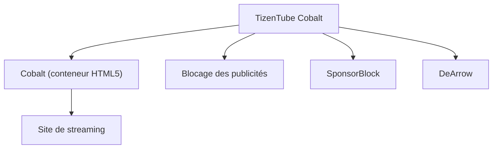

# reisxd/TizenTubeCobalt

> Cobalt-based application that removes ads from a video streaming site on television.

## The problem
Watching streaming videos on a TV or set-top box means ads, misleading titles and sponsored segments.

## What it actually does
Provides an application built on Cobalt, Google's lightweight HTML5 container for constrained devices. It blocks ads, skips sponsored segments (SponsorBlock), adjusts playback speed and cleans up clickbait titles (DeArrow). The README is short: technical details are not documented.

## How it is wired
Simplified diagram based on the sheet, no diagram provided.

## Trying it
No command documented in the README: download the latest release, then install it on the device via a file manager, ADB or the platform's own method.

## Cost and gotchas
Free. Installation is by sideloading. The README recommends a Google TV certified device.

## What it is not
Not an official application of the streaming service. Bypassing ads may violate the site's terms of use. The README says nothing about the architecture or precisely which devices are supported.

## Alternatives
No alternative named in the README.

## For you
To ignore: a TV application unrelated to data or AI, and too poorly documented to be evaluated.
